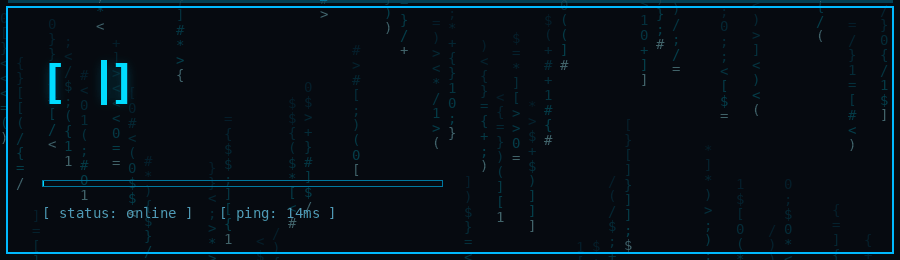
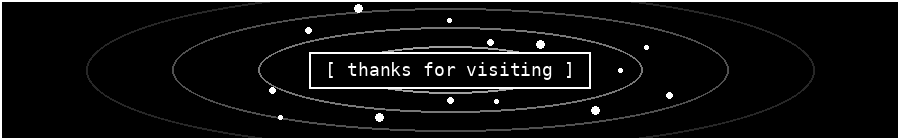

<div align="center">



<a href="https://github.com/saberssr114?tab=followers"></a>
<a href="https://github.com/saberssr114?tab=repositories"></a>


</div>

### [ About Me ]
```js
const saberssr114 = {
  role: "Developer & Creator",
  focus: ["Web apps", "Desktop tools", "UI design"],
  currentlyBuilding: "something awesome",
  motto: "Limitless ideas"
};
```

### [ Tech Stack ]
<div align="center">


</div>

### [ GitHub Stats ]
<div align="center">


<br/>


<br/>


</div>

### [ Contribution Graph ]
<div align="center">


</div>

### [ Connect ]
<div align="center">

[](https://github.com/saberssr114)



</div>
